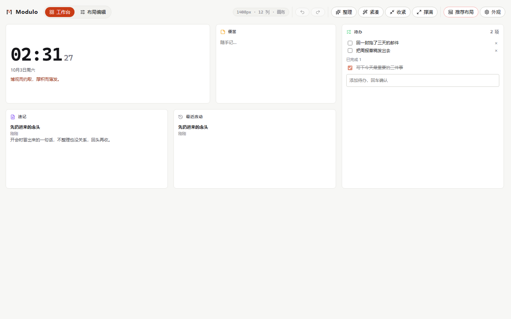

# Modulo

> **自适应的自由编排工作台** —— 逻辑网格恒定，物理列数随屏幕投影。

一份 12 列布局，从 1920 桌面到 390 手机都能编排、都能读、都能用键盘操作。



## 三条不可让渡的差异点

对着既有实现（x-hub）的实机短板逐条定的目标；取舍与实测数据见 [docs/ARCHITECTURE.md](docs/ARCHITECTURE.md)。

| 差异点 | 意义 |
| --- | --- |
| **真响应式** | 12 列逻辑版面按容器宽度投影成 12 / 8 / 6 / 4 / 1 档，窄屏自动降档形态，绝不出现被截断的碎片卡 |
| **键盘可达** | 增 / 移 / 缩 / 切形态 / 删 / 撤销，全程键盘完成 |
| **可回退** | 50 步历史栈，拖拽与缩放各自成一条历史 |

## 布局引擎（已发布 npm）

布局投影是**纯函数、零框架依赖**（不 import vue、不碰 DOM），能脱离 UI 直接单测，已独立发布：

```bash
npm install @levango7/engine
```

```js
import { projectForWidth, emptyDoc } from '@levango7/engine'

const registry = [{
  id: 'clock', title: '时钟', defaultVariant: 'big',
  variants: [{ id: 'big', name: '大时钟', minW: 3, minH: 3, idealW: 4, idealH: 3 }],
}]
const doc = {
  ...emptyDoc(),
  items: [{ id: 'clock', variant: 'big', x: 0, y: 0, w: 4, h: 3 }],
}

// 390px 手机宽：自动降档，不产生碎片卡
const { rects } = projectForWidth(doc, registry, 390)
```

引擎保证五条不变量（只读、幂等、无重叠、尺寸充分、分区完整），每条都有属性测试守着。
完整 API 与两种消费方式（仓库内吃 `src/`、包外吃 `dist/`）见
[packages/engine/README.md](packages/engine/README.md)。

## 现在有什么

- **49 种卡片**：时钟 / 待办 / 便签 / 图表 / 监控 / 节假日 / 股票行情 / RSS …… 清单与逐批状态见 [docs/CARD-CATALOG.md](docs/CARD-CATALOG.md)；
- **双形态同源**：网页端与桌面端（Tauri）共用同一套渲染与引擎；
- **浮窗**：卡片可以脱离工作台，变成桌面小窗常驻；
- 版本与逐版摘要见 [CHANGELOG.md](CHANGELOG.md)。

## 开发

```bash
npm install
npm run dev        # 网页端
npm run tauri:dev  # 桌面端
npm test           # 单元 + 引擎属性测试
npm run typecheck
npm run verify     # 提交前的综合校验
```

E2E（Playwright）：`npm run test:e2e`。发布与签名口径见
[CODE_SIGNING_POLICY.md](CODE_SIGNING_POLICY.md) 与 `release-manifest.json`。

## 文档索引

| 文档 | 内容 |
| --- | --- |
| [docs/ARCHITECTURE.md](docs/ARCHITECTURE.md) | 架构与选型：投影模型、五条不变量、历史栈、渲染层取舍 |
| [docs/CARD-CATALOG.md](docs/CARD-CATALOG.md) | 卡片目录：49 种卡的形态矩阵与交付状态 |
| [CONTRIBUTING.md](CONTRIBUTING.md) | 参与开发：环境、测试、提交口径 |
| [docs/AGENT-COORD.md](docs/AGENT-COORD.md) | 多 agent 并行时的作业面协调约定（含 junction 陷阱说明） |

## 许可

[Apache-2.0](LICENSE)
